# Loom

Summarize, rewrite, translate and chat with your Obsidian notes using the AI model of your choice. Run a model on your own computer (Ollama, LM Studio, llama.cpp), or connect a hosted one (Claude, OpenAI, DeepSeek, Grok and more).

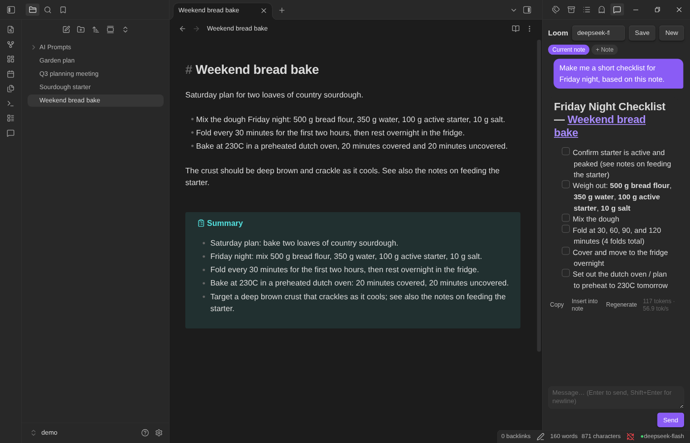

**What you get**

- **One-click editing actions**: summarize, fix grammar, rewrite shorter, more formal or more casual, continue writing, pull out action items, suggest titles, tags and links, translate.
- **A chat panel** that can read the note you're working on, or any other notes you attach.
- **Ask your vault**: ask a question in plain English and get an answer drawn from your own notes.
- **Related notes**: a side panel that shows which other notes are about the same thing.
- **A digest** of what you changed in the last day or week.
- **Your own prompts**: turn any note into a reusable action.

Loom never edits a note without showing you the result first (unless you turn that on).

---

## Contents

1. [Quick start](#quick-start)
2. [Install](#install)
3. [Connect a model](#connect-a-model)
4. [Using Loom](#using-loom)
5. [Settings](#settings)
6. [Privacy](#privacy)
7. [Troubleshooting](#troubleshooting)
8. [Development](#development)

---

## Quick start

1. **Install Loom** into your vault: run `./install.sh` and follow the prompts ([details](#install)).
2. **Restart Obsidian** and turn Loom on if it isn't already (Settings → Community plugins).
3. **Connect a model**: press `Ctrl/Cmd + P`, run **Loom: Connect to a model…**, pick a provider, paste an API key if it needs one, and press **Test connection**.

Then open a note, press `Ctrl/Cmd + P`, type "Loom" and try **Loom: Summarize**.

---

## Install

### With the installer (recommended)

You need [Node.js](https://nodejs.org) (to build the plugin) and [Go](https://go.dev/dl/) (to run the installer). From the Loom folder:

```bash
./install.sh
```

The first run builds the plugin, then opens a text-mode installer.

**1. Pick your vault.** Vaults Obsidian already knows about are listed, most recently used first. If yours isn't there, choose **Type a path…** or **Browse folders…**.

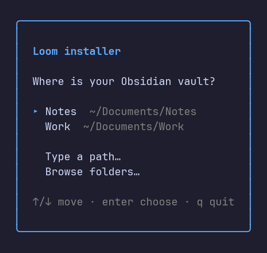

**2. Browse (optional).** Move with the arrow keys. `→` or `l` opens a folder, `←` or `h` goes up. Press `enter` on a folder to choose it, or `.` to choose the folder you're looking at.

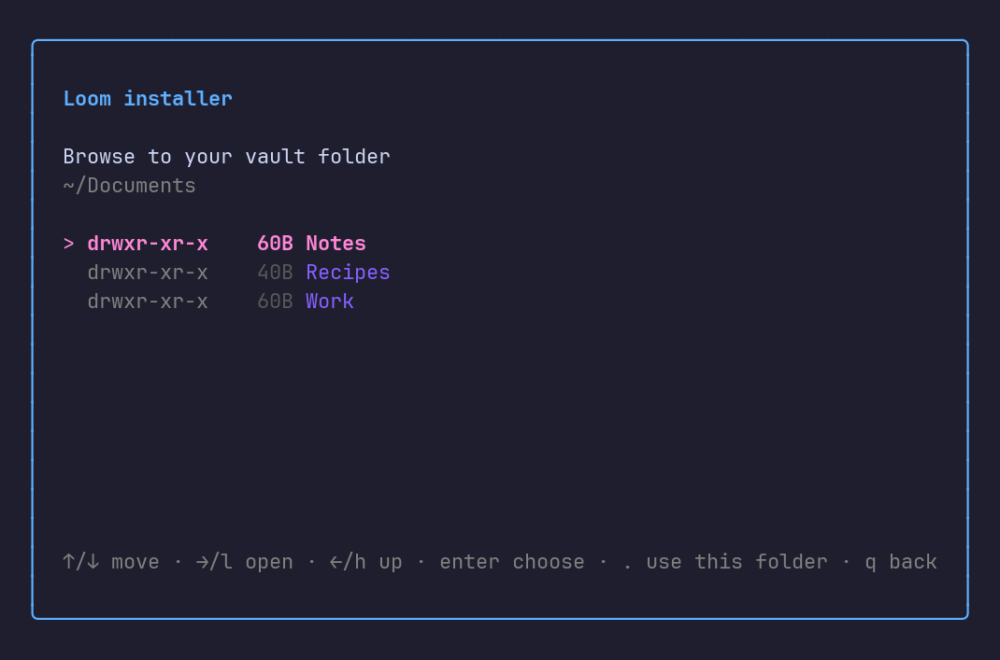

If the folder isn't an Obsidian vault, the installer tells you why and lets you keep looking. A vault is a folder with a hidden `.obsidian` folder inside it, which Obsidian creates the first time you open it.

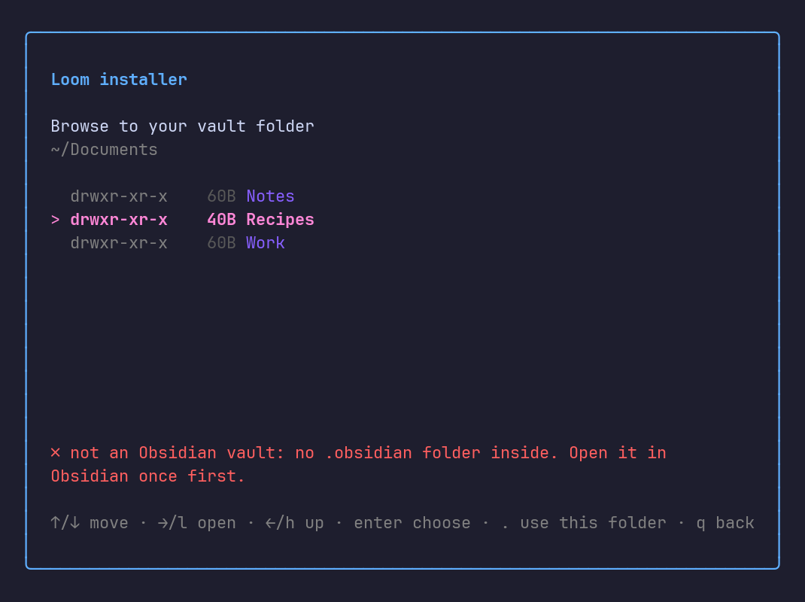

**3. Choose options.** The defaults are right for most people: copy the files, and turn Loom on in that vault.

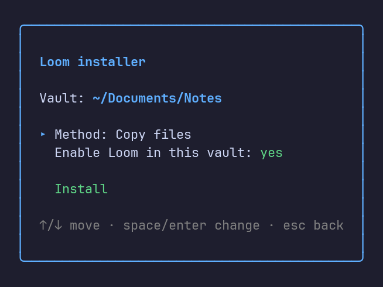

**4. Install.** Select **Install** and press `enter`.

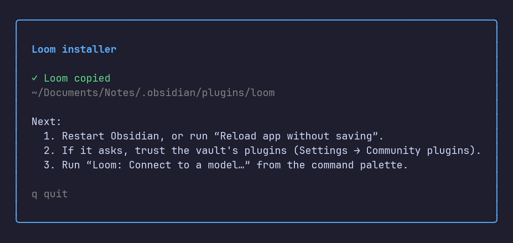

Then restart Obsidian (or run **Reload app without saving** from the command palette). If Obsidian asks whether you trust the vault's plugins, choose **Trust author and enable plugins**.

Your settings and API key are kept when you run the installer again to update Loom.

**Installer options**

| Option | What it does |
| --- | --- |
| `--vault PATH` | Skip the menus and install straight into this vault |
| `--link` | Link to this folder instead of copying (for development: rebuild and reload to see changes) |
| `--no-enable` | Install but don't turn the plugin on |
| `--force` | With `--link`, replace a plugin folder that already exists |
| `--src DIR` | Where the built plugin is (found automatically) |
| `--uninstall` | Remove Loom from `--vault` |

Example: `./install.sh --vault ~/Documents/Notes`

On Windows, or without Bash, run `npm install && npm run build`, then `cd installer && go run .`.

### By hand

If you'd rather not run the installer:

1. Run `npm install && npm run build` in the Loom folder.
2. In your vault, create the folder `.obsidian/plugins/loom/`.
3. Copy `main.js`, `manifest.json` and `styles.css` into it.
4. Restart Obsidian, open **Settings → Community plugins**, turn on community plugins if they're off, and switch **Loom** on.

If you don't see Loom in the list, click the refresh icon next to **Installed plugins**.

---

## Connect a model

Loom needs a model to talk to. You can run one on your own computer, or use a hosted service.

Open the command palette (`Ctrl/Cmd + P`) and run **Loom: Connect to a model…**. This guided setup also opens the first time you start Loom.

**1. Pick a provider.** Choosing one fills in the right address for you, and shows a short note about it.

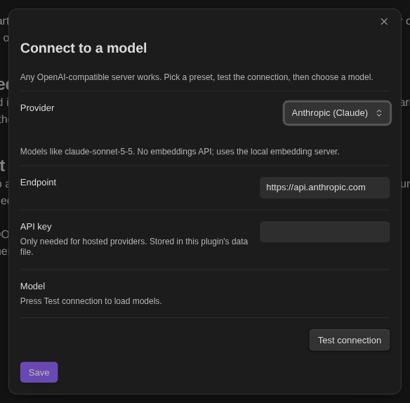

**2. Paste your API key** if the provider needs one (see the table below). Local servers don't.

**3. Press Test connection.** A green message means it worked, and the **Model** menu fills with the models that provider offers. Pick one. A red message means Loom couldn't connect: check the address and key.

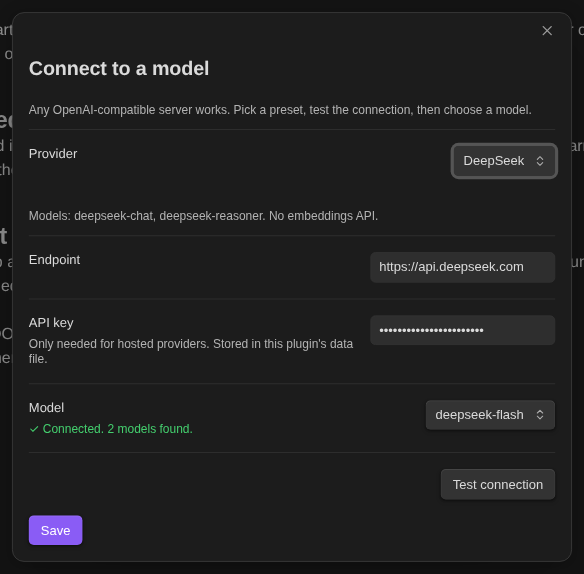

**4. Press Save.**

### Which provider?

| Provider | Needs a key? | Where to get one | Notes |
| --- | --- | --- | --- |
| **Ollama** | No | [ollama.com](https://ollama.com) | Free and private, runs on your computer |
| **LM Studio** | No | [lmstudio.ai](https://lmstudio.ai) | Free and private; start its local server first |
| **llama.cpp server** | No | [github.com/ggml-org/llama.cpp](https://github.com/ggml-org/llama.cpp) | Free and private; for people comfortable with the command line |
| **OpenAI** | Yes | [platform.openai.com/api-keys](https://platform.openai.com/api-keys) | Includes an embeddings model |
| **Anthropic (Claude)** | Yes | [console.anthropic.com](https://console.anthropic.com) | Chat only: no embeddings |
| **DeepSeek** | Yes | [platform.deepseek.com](https://platform.deepseek.com) | Chat only: no embeddings |
| **xAI (Grok)** | Yes | [console.x.ai](https://console.x.ai) | Chat only: no embeddings |
| **Groq** | Yes | [console.groq.com](https://console.groq.com) | Chat only: fast hosted open models |
| **Mistral** | Yes | [console.mistral.ai](https://console.mistral.ai) | Includes embeddings |
| **Together AI** | Yes | [api.together.ai](https://api.together.ai) | Includes embeddings |
| **OpenRouter** | Yes | [openrouter.ai/keys](https://openrouter.ai/keys) | One key for many models, including Claude |
| **Custom** | Depends | | Any server that speaks the OpenAI API |

Hosted providers charge for use. Check the provider's pricing before you turn on features that send a lot of text, such as **Digest**.

### Setting up a local model

You only need this if you chose Ollama, LM Studio or llama.cpp.

- **Ollama**: install it, then in a terminal run `ollama pull llama3.2`. Ollama runs in the background and Loom finds it at `http://127.0.0.1:11434`.
- **LM Studio**: download a model, open the **Developer** tab, and start the local server (default `http://127.0.0.1:1234`).
- **llama.cpp**: run `llama-server -m your-model.gguf --port 8080`.

### Embeddings (for "Ask your vault" and "Related notes")

Two features work by comparing the meaning of your notes. They need an **embeddings model**, which is separate from the chat model.

- **Ollama**: the preset uses `nomic-embed-text`. Run `ollama pull nomic-embed-text` once.
- **LM Studio**: the preset uses `text-embedding-nomic-embed-text-v1.5`. Download that embedding model in LM Studio and keep the server running.
- **llama.cpp**: it doesn't serve embeddings alongside chat here, so the preset looks for an embedding server (such as LM Studio) at `http://127.0.0.1:1234`.
- **OpenAI, Mistral, Together and OpenRouter** use their own hosted embeddings.
- **Claude, DeepSeek, Grok and Groq don't offer embeddings.** Loom keeps using a local embedding server for those. If you don't run one, everything still works except **Ask your vault** and **Related notes**.

You can change the embedding address and model any time in Loom's settings.

---

## Using Loom

### Editing actions

Open a note, select some text (or select nothing to use the whole note), then do either of these:

- Press `Ctrl/Cmd + P`, type **Loom**, and pick an action.
- Right-click in the note and choose **Loom: run action…**.

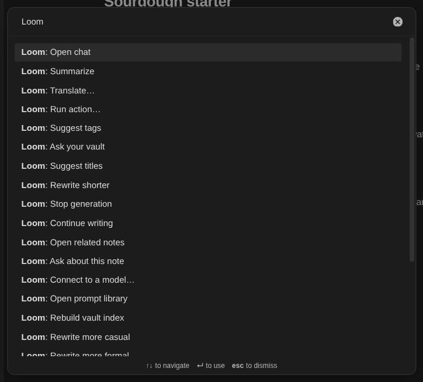

You'll see a window with the model's answer as it arrives:

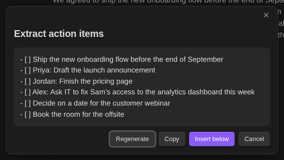

- **Insert below** or **Replace** puts the result in your note. Which one you get depends on the action: rewrites replace your text, while summaries and lists are added underneath.
- **Regenerate** asks again for a different answer.
- **Copy** copies it without touching your note.
- **Cancel** throws it away.

Summaries are added as a callout:

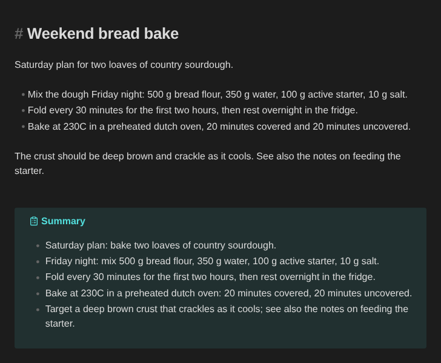

| Action | What it does |
| --- | --- |
| Summarize | A short paragraph (plus bullets only when the text has real list items), added below as a callout |
| Fix grammar and spelling | Corrects errors without changing your wording |
| Rewrite shorter / more formal / more casual | Replaces the text with a rewrite |
| Continue writing | Adds a continuation in the same voice |
| Extract action items | Turns the text into a `- [ ]` task list |
| Suggest titles | Five title ideas |
| Suggest tags | Tags, preferring ones you already use |
| Suggest links to other notes | `[[Wikilinks]]` to other notes in your vault |
| Translate… | Pick a language; replaces the text with the translation |
| Ask about this note | Type a question and get an answer based only on this note |

You can also run **Loom: Run action…** to pick from a list that includes your own prompts:

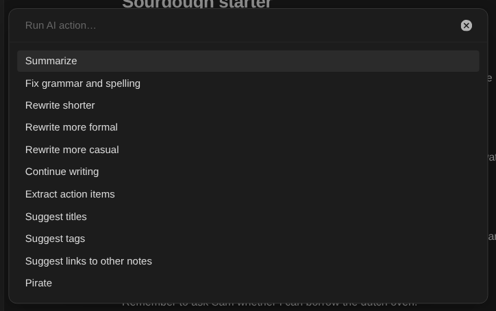

### Chat

Click the speech-bubble icon in the left sidebar, or run **Loom: Open chat**.

- The **Current note** chip means the model can read the note you have open. Click it to turn that off.
- **+ Note** attaches other notes to the conversation.
- Press `Enter` to send, `Shift + Enter` for a new line.
- Under each answer: **Copy**, **Insert into note** (adds it to the note you were last editing) and **Regenerate**.
- **Save** turns the whole conversation into a note. **New** starts over.
- The menu at the top switches models.

Your chat is remembered when you restart Obsidian.

### Ask your vault

Run **Loom: Ask your vault**, type a question, and Loom finds the most relevant parts of your notes and answers from them, linking the notes it used.

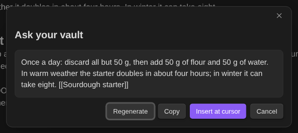

The first time, Loom reads and indexes your notes, which can take a minute in a big vault. After that it only re-reads notes that changed. Run **Loom: Rebuild vault index** if results seem out of date. This needs an [embeddings model](#embeddings-for-ask-your-vault-and-related-notes).

### Related notes

Run **Loom: Open related notes** for a side panel listing the notes most similar to the one you have open. Click one to open it.

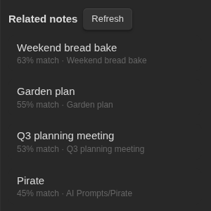

### Digest

Run **Loom: Digest recent notes…**, choose **Last day** or **Last 7 days**, and Loom summarizes what you've been working on. Press **Save as note** to keep it.

### Your own prompts

There are two ways to add your own actions.

**A prompt library** (best for longer prompts). Run **Loom: Open prompt library**. Loom creates a folder called `AI Prompts` with an example. Every note in that folder becomes an action in **Run action…**. Write the instruction as the body of the note:

```markdown
---
mode: below
---
Explain the following to a beginner. The note is titled "{{title}}" (today is {{date}}).

{{selection}}
```

Without the `mode: below` line, the result replaces your selection. With it, the result is added underneath.

**Custom actions** (best for one-liners). In Loom's settings, add one per line in the form `Name: instruction`:

```
Shout: Rewrite the text in ALL CAPS
Bullets: Turn the text into a bulleted list
```

In both, you can use these placeholders:

| Placeholder | Becomes |
| --- | --- |
| `{{selection}}` | The selected text, or the whole note if nothing is selected |
| `{{note}}` | The whole note |
| `{{title}}` | The note's title |
| `{{date}}` | Today's date |

### The status bar

The bottom-right corner shows which model you're using. A **green dot** means Loom can reach the server; a **red dot** means it can't. Click it to switch models.

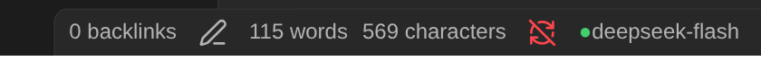

---

## Settings

Open **Settings → Loom**.

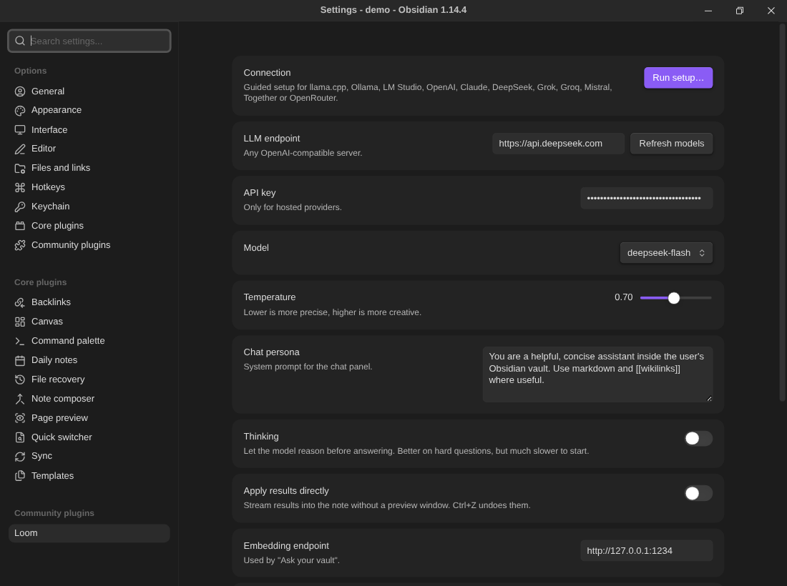

| Setting | What it does |
| --- | --- |
| **Connection** | Opens the guided setup |
| **LLM endpoint** | The address of the server. Any OpenAI-compatible server works |
| **API key** | For hosted providers. Stored in your vault (see [Privacy](#privacy)) |
| **Model** | The model to use. Press **Refresh models** to reload the list |
| **Temperature** | Lower gives more predictable answers, higher gives more creative ones |
| **Chat persona** | The instructions the chat panel starts with. Change it to give the assistant a different style |
| **Thinking** | Lets local models reason before answering. Slower to start. Only applies to local servers |
| **Apply results directly** | Skips the preview window and writes straight into your note. Press `Ctrl/Cmd + Z` to undo |
| **Embedding endpoint / model** | Used by Ask your vault and Related notes. Changing the model rebuilds the index |
| **Prompt library folder** | The folder whose notes become actions. Default: `AI Prompts` |
| **Custom actions** | Your own one-line actions |

---

## Privacy

- **Local models** (Ollama, LM Studio, llama.cpp): your notes never leave your computer.
- **Hosted providers**: when you run an action or chat, the text it needs (the selection, the note, notes you attach, or the pieces **Ask your vault** finds) is sent to that provider. Check their privacy policy. Loom only sends what a feature needs, and only when you use it.
- **Related notes and Ask your vault** send your note text to the **embedding server** to build the index. With a hosted embeddings provider, that means your notes go there. With Ollama or LM Studio they stay on your computer.
- **Your API key** is stored in a file called `data.json` inside the plugin folder (`.obsidian/plugins/loom/`) in your vault. It is only sent to the server it belongs to, never to the embedding server unless that is the same host. **If you sync your vault** (Obsidian Sync, Remotely Save, iCloud, Dropbox, Git), `data.json` goes with it. Exclude `.obsidian/plugins/loom/data.json` from sync or from Git if you don't want that.

---

## Troubleshooting

**Loom isn't in my plugin list.**
Restart Obsidian, or click the refresh icon next to **Installed plugins**. Then check that **Settings → Community plugins → Turn on community plugins** has been done. Check that the folder `.obsidian/plugins/loom/` in your vault contains `main.js` and `manifest.json`.

**Obsidian asks "Do you trust the author of this vault?"**
That's Obsidian's normal check the first time a vault has plugins. Choose **Trust author and enable plugins** to let Loom run.

**The status dot is red.**
Loom can't reach the server. For a local model, check it's running (open Ollama, LM Studio or your llama.cpp server). For a hosted provider, check the key and your internet connection. Run **Loom: Connect to a model…** and press **Test connection** to see the details.

**"Test connection" fails with a hosted provider.**
Check the API key for typos or extra spaces, and that the account has credit. Make sure you chose the right provider; each key only works with its own provider.

**"Cannot reach the server at http://127.0.0.1:1234" in Related notes or Ask your vault.**
Those features need an embeddings server. Start LM Studio or Ollama with an embedding model, or switch to a provider that has embeddings. See [Embeddings](#embeddings-for-ask-your-vault-and-related-notes).

**"Model returned no text."**
The model gave an empty answer. Press **Regenerate**. If it keeps happening with a local model, try turning **Thinking** off, or choose a different model.

**I can't run an action: nothing happens.**
Editing actions only work while a note is open in **editing** mode. In reading view they are unavailable. Switch to the editor first (`Ctrl/Cmd + E`).

**I changed Loom's code and don't see the change.**
Run `npm run build`, then reload Obsidian (**Reload app without saving**).

---

## Development

```bash
npm install
npm run dev        # rebuilds on change
npm run build      # type-checks, then makes a production main.js
```

Link the folder into a vault so changes show up straight away:

```bash
./install.sh --vault ~/Documents/Notes --link
```

Reload Obsidian after each build (**Reload app without saving**).

**Layout**

| File | What it holds |
| --- | --- |
| `main.ts` | The plugin: commands, settings page, status bar |
| `llm.ts` | Talking to the model (streaming chat, embeddings), and the provider presets |
| `actions.ts` | The built-in actions and the template placeholders |
| `ui.ts` | The chat panel, result window, setup wizard and related-notes panel |
| `vault.ts` | The vault index used by Ask your vault and Related notes |
| `installer/` | The Go installer (`go test ./...` inside it to run its tests) |

To add a provider, add a line to `PROVIDERS` in `llm.ts`. Any server that speaks the OpenAI API (`/v1/chat/completions`) will work.
